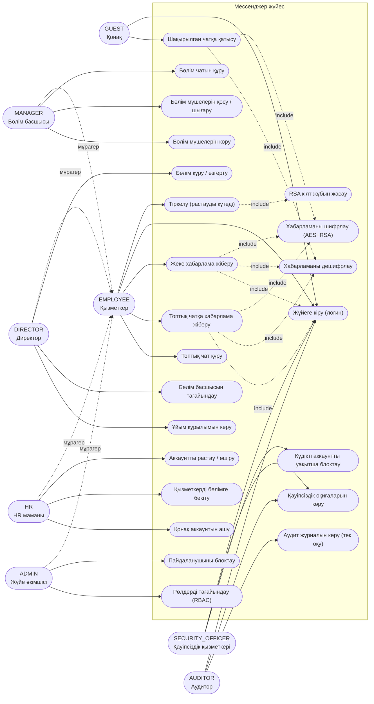
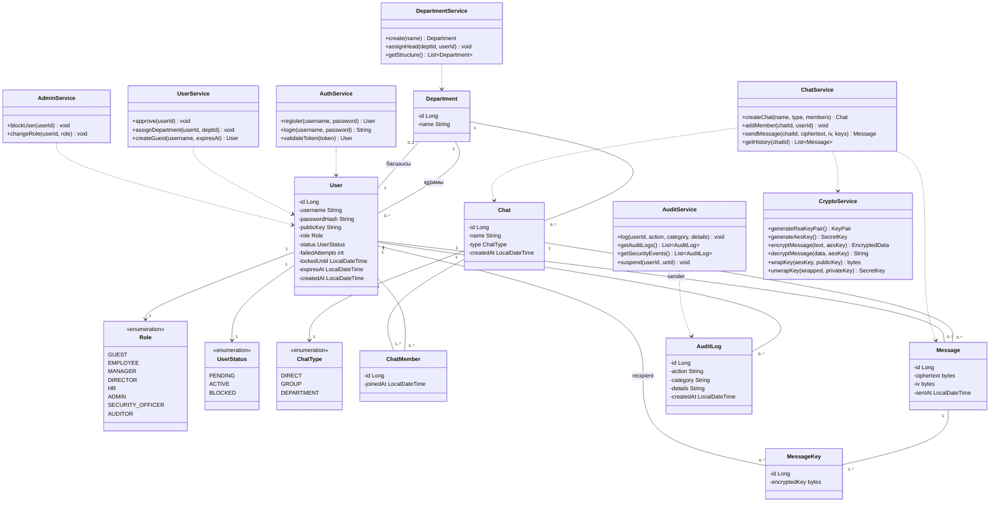
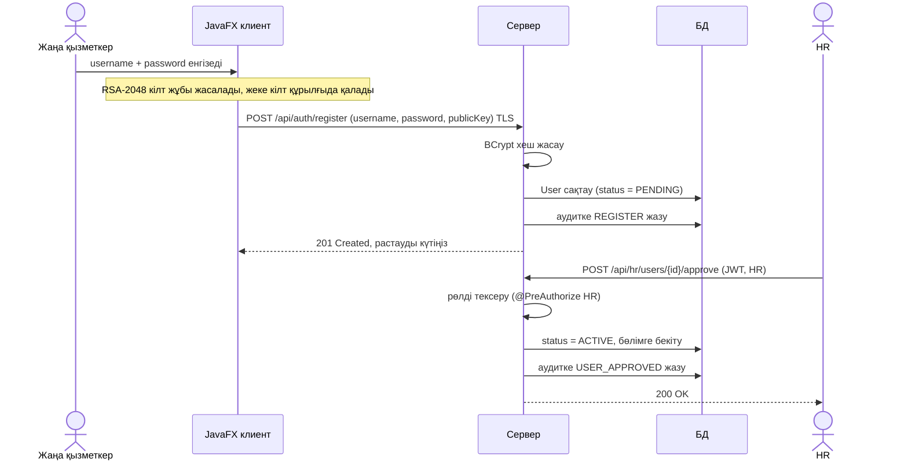
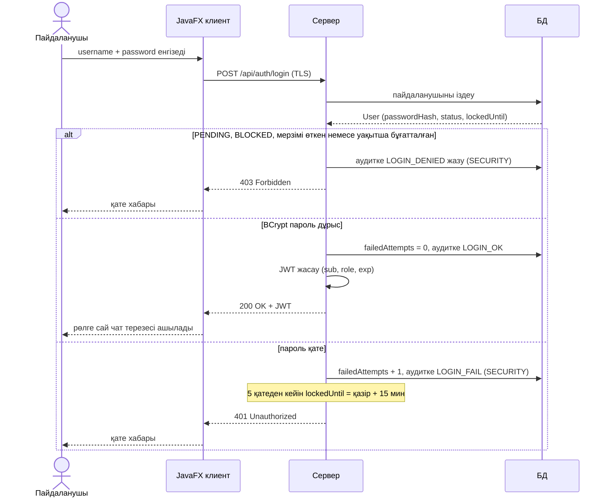
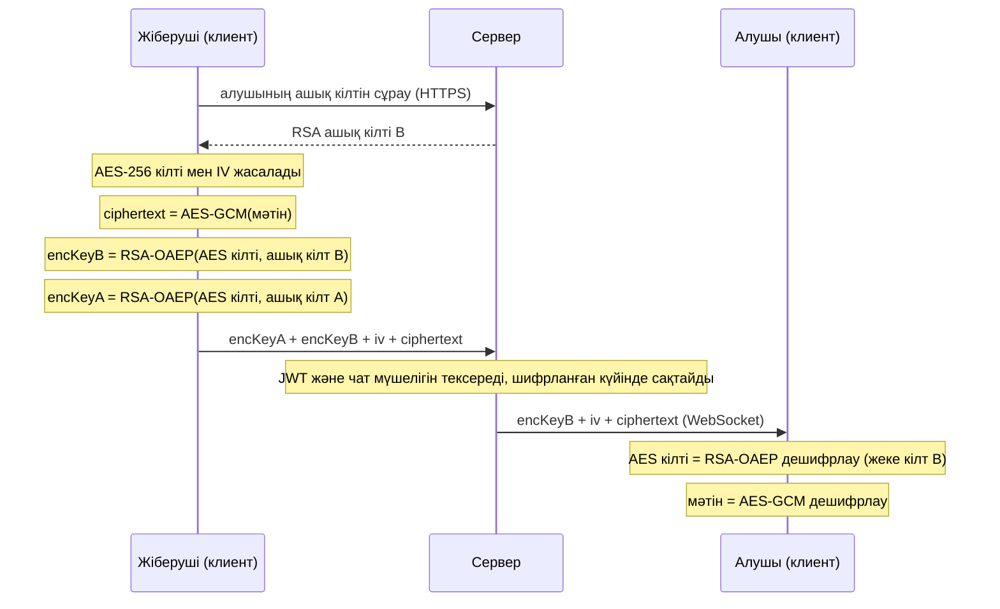
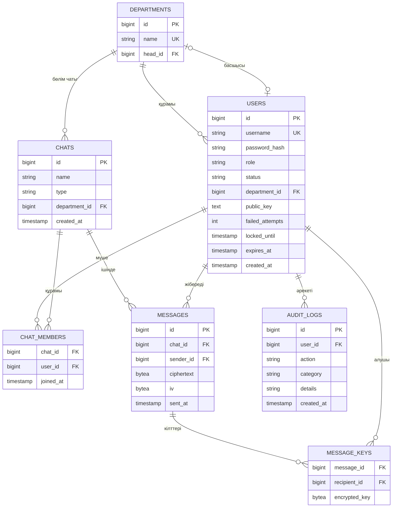

# secure-messenger

Қауіпсіз корпоративтік мессенджер (Java 17, Spring Boot, JavaFX).

Шифрланған клиент–сервер чат: аутентификация, 8 корпоративтік рөл (RBAC), бөлімдер, жеке/топтық/бөлім чаты, аккаунтты растау (HR), қауіпсіздік оқиғалары, аудит журналы.

## Мазмұны
1. [Мақсат және мүмкіндіктер](#1-мақсат-және-мүмкіндіктер)
2. [Технологиялар](#2-технологиялар)
3. [Рөлдер және рұқсат матрицасы](#3-рөлдер-және-рұқсат-матрицасы)
4. [Қауіпсіздік шешімдері](#4-қауіпсіздік-шешімдері)
5. [Модульдер](#5-модульдер-maven)
6. [UML диаграммалары](#6-uml-диаграммалары)
7. [API](#7-api)
8. [Тестілеу жоспары](#8-тестілеу-жоспары)
9. [Негізгі тәуекелдер](#9-негізгі-тәуекелдер)
10. [Спринттер және мерзімдер](#10-спринттер-және-мерзімдер)
11. [Команда](#11-команда)
12. [Research](#12-research)
13. [Қорғау сценарийі (demo)](#13-қорғау-сценарийі-demo)

## 1. Мақсат және мүмкіндіктер
- Шифрланған клиент–сервер чат (RSA-2048 + AES-256-GCM, TLS)
- Тіркелу (HR растағанға дейін `PENDING`), логин, JWT аутентификациясы
- 8 корпоративтік рөл: `GUEST`, `EMPLOYEE`, `MANAGER`, `DIRECTOR`, `HR`, `ADMIN`, `SECURITY_OFFICER`, `AUDITOR`
- Бөлімдер (departments) және ұйым құрылымы
- Жеке, топтық және бөлім чаты, сыртқы қонақты чатқа шақыру
- Қауіпсіздік оқиғалары (қате логиндер, блоктау) және өзгертуге болмайтын аудит журналы

## 2. Технологиялар
| Бөлім | Таңдау | Себебі |
|---|---|---|
| Тіл | Java 17+ | Тапсырма талабы |
| Сервер | Spring Boot (Web, Security, WebSocket, Data JPA) | Дайын аутентификация, REST және WebSocket |
| Клиент | JavaFX | Тапсырма талабы, десктоп UI |
| Криптография | JCA (java.security, javax.crypto) | Стандартты кітапхана, сыртқы тәуелділік керек емес |
| БД | PostgreSQL (production), H2 (тест/даму) | H2 CI-да жеңіл |
| Құрастыру | Maven (көп модульді) | Модульдерді бөлу оңай |
| Тест | JUnit 5, Spring Security Test | Кемінде 20 тест талап етіледі |
| CI | GitHub Actions | Автотест |

## 3. Рөлдер және рұқсат матрицасы

Қағида: **міндеттерді бөлу**. Ешкім өзі үшін шешім қабылдамайды: HR аккаунтты растайды, ADMIN рөл береді, SECURITY_OFFICER күдікті аккаунтты тоқтатады, AUDITOR бәрін тек оқиды. Ешкім өз рөлін өзгерте алмайды. Бірде-бір рөл хабарлама мәтінін көре алмайды (шифрланған).

| Рөл | Кім | Негізгі міндеті |
|---|---|---|
| `GUEST` | Сыртқы қонақ (мердігер, кеңесші) | Тек шақырылған чатқа кіріп жазады. Мерзімі шектеулі (`expires_at`), чат құра алмайды |
| `EMPLOYEE` | Қарапайым қызметкер | Тіркелу, логин, жеке және топтық чат, хабарлама жіберу/оқу |
| `MANAGER` | Бөлім басшысы | `EMPLOYEE` + өз бөлімінің чатын құру, бөлім мүшелерін қосу/шығару/көру |
| `DIRECTOR` | Директор | `EMPLOYEE` + бөлім құру/өзгерту, бөлім басшысын тағайындау, ұйым құрылымын көру |
| `HR` | HR маманы | `EMPLOYEE` + аккаунтты растау/өшіру, қызметкерді бөлімге бекіту, қонақ аккаунтын ашу |
| `ADMIN` | Жүйе әкімшісі | `EMPLOYEE` + пайдаланушыны блоктау, рөл тағайындау |
| `SECURITY_OFFICER` | Қауіпсіздік қызметкері | Қауіпсіздік оқиғаларын көру, күдікті аккаунтты уақытша блоктау |
| `AUDITOR` | Аудитор | Аудит журналын тек оқу |

Рұқсат матрицасы (✓ рұқсат, бос орын тыйым, сервер `403` қайтарады):

| Әрекет | GUEST | EMPLOYEE | MANAGER | DIRECTOR | HR | ADMIN | SEC. OFF. | AUDITOR |
|---|:-:|:-:|:-:|:-:|:-:|:-:|:-:|:-:|
| Логин | ✓ | ✓ | ✓ | ✓ | ✓ | ✓ | ✓ | ✓ |
| Тіркелу | | ✓ | ✓ | ✓ | ✓ | ✓ | | |
| Шақырылған чатқа қатысу/жазу | ✓ | ✓ | ✓ | ✓ | ✓ | ✓ | | |
| Жеке және топтық чат құру | | ✓ | ✓ | ✓ | ✓ | ✓ | | |
| Бөлім чатын құру | | | ✓ | | | | | |
| Бөлім мүшелерін қосу/шығару/көру | | | ✓ | | | | | |
| Бөлім құру, басшы тағайындау, құрылымды көру | | | | ✓ | | | | |
| Аккаунтты растау/өшіру, бөлімге бекіту | | | | | ✓ | | | |
| Қонақ аккаунтын ашу | | | | | ✓ | | | |
| Пайдаланушыны блоктау | | | | | | ✓ | | |
| Рөл тағайындау | | | | | | ✓ | | |
| Қауіпсіздік оқиғаларын көру | | | | | | | ✓ | ✓ |
| Күдікті аккаунтты уақытша блоктау | | | | | | | ✓ | |
| Аудит журналын көру (тек оқу) | | | | | | | | ✓ |

`MANAGER` тек өз бөлімін басқарады. Бөлім шектеуін де сервер тексереді.

## 4. Қауіпсіздік шешімдері
- **Пароль:** BCrypt арқылы хэштеледі, ашық түрде сақталмайды. Ең аз ұзындық 10 таңба.
- **Аккаунт өмірі:** тіркелген аккаунт `PENDING` болады, HR растағаннан кейін `ACTIVE`. `PENDING` және `BLOCKED` аккаунт логин жасай алмайды. `GUEST` мерзімі өткенде кіре алмайды.
- **Brute-force қорғанысы:** 5 қате логиннен кейін аккаунт 15 минутқа бұғатталады (`locked_until`), әр қате `SECURITY` санатымен аудитке жазылады.
- **Аутентификация:** логиннен кейін JWT беріледі (`sub`, `role`, `exp`), токен өмірі қысқа.
- **RBAC:** 8 рөл, рұқсат `@PreAuthorize` арқылы тексеріледі, рұқсат жоқ болса `403`. UI батырманы жасырса да, шешімді сервер қабылдайды.
- **Байланыс:** TLS (HTTPS/WSS), development кезінде self-signed сертификат.
- **Хабарлама шифрлауы (гибридті):**
  1. Әр пайдаланушы тіркелгенде RSA-2048 кілт жұбын жасайды. Жеке кілт клиентте қалады, ашық кілт серверге жіберіледі.
  2. Әр хабарламаға жаңа AES-256-GCM кілті және кездейсоқ `iv` жасалады, хабарлама осымен шифрланады (`ciphertext` + `iv` сақталады).
  3. AES кілті чаттың әр мүшесінің және жіберушінің RSA ашық кілтімен бөлек шифрланып, `message_keys` ішінде сақталады.
  4. Сервер тек шифрланған деректі көреді және сақтайды.
- **Аудит:** логин (сәтті/сәтсіз), рөл өзгерісі, аккаунтты растау, блоктау, чат құру журналға жазылады. Хабарлама мәтіні жазылмайды. Журналға тек қосу (append-only) жүреді, өзгертуге/өшіруге API жоқ.
- **Құпия деректер:** keystore, JWT secret және БД паролі репозиторийге түспейді, environment variables арқылы беріледі.

## 5. Модульдер (Maven)
```
secure-messenger/
├── common/      # DTO, Role, ортақ класстар
├── crypto/      # RSA+AES (JCA), JUnit тесттер
├── server/      # Spring Boot: auth, RBAC, chat, department, admin, audit
├── client/      # JavaFX UI
├── docs/uml/    # PlantUML бастапқы кодтары
└── .github/workflows/ci.yml
```

## 6. UML диаграммалары

Диаграммалар Mermaid форматында жазылған, сондықтан GitHub-та README ішінде тікелей көрінеді. PlantUML бастапқы кодтары `docs/uml/` папкасында.

### Use case диаграммасы



Аудитор мен қауіпсіздік қызметкері чат жазбайды және хабарлама мәтінін көрмейді (шифрланған). Аудитор тек оқиды, ештеңені өзгерте алмайды.

Бастапқы код (PlantUML): [01-usecase.puml](docs/uml/01-usecase.puml)

### Class диаграммасы



Бастапқы код (PlantUML): [02-class.puml](docs/uml/02-class.puml)

### Sequence: тіркелу және HR растауы



### Sequence: логин



### Sequence: хабарлама жіберу



Бастапқы код (PlantUML): [04-sequence-message.puml](docs/uml/04-sequence-message.puml)

### ER диаграммасы



## 7. API

| Endpoint | Рөл | Сипаттама |
|---|---|---|
| `POST /api/auth/register` | ашық | Тіркелу (`PENDING`) |
| `POST /api/auth/login` | ашық | Логин, JWT қайтарады |
| `GET /api/chats`, `POST /api/chats` | EMPLOYEE+, GUEST (тек оқу/жазу) | Чат тізімі, чат құру |
| `POST /api/chats/{id}/messages` | чат мүшесі | Шифрланған хабарлама жіберу |
| `POST /api/chats/{id}/members` | MANAGER (өз бөлімі) | Мүше қосу/шығару |
| `GET /api/departments` | DIRECTOR | Ұйым құрылымы |
| `POST /api/departments`, `PUT /api/departments/{id}/head` | DIRECTOR | Бөлім құру, басшы тағайындау |
| `POST /api/hr/users/{id}/approve`, `DELETE /api/hr/users/{id}` | HR | Аккаунтты растау/өшіру |
| `PUT /api/hr/users/{id}/department` | HR | Бөлімге бекіту |
| `POST /api/hr/guests` | HR | Қонақ аккаунтын ашу |
| `PUT /api/admin/users/{id}/block`, `PUT /api/admin/users/{id}/role` | ADMIN | Блоктау, рөл тағайындау |
| `GET /api/security/events`, `PUT /api/security/users/{id}/suspend` | SECURITY_OFFICER | Оқиғалар, уақытша блоктау |
| `GET /api/audit` | AUDITOR | Аудит журналы (тек оқу) |

## 8. Тестілеу жоспары

Кемінде 20 JUnit 5 тест, CI-да `mvn -B verify` арқылы жүреді.

| Санат | Мысал тесттер | Саны |
|---|---|---|
| Криптография | AES-GCM шифрлау/дешифрлау, дұрыс емес кілт қате береді, өзгертілген ciphertext GCM tag-тан өтпейді, RSA-OAEP wrap/unwrap, IV әр хабарламада әртүрлі | 6 |
| Аутентификация | BCrypt хеш ашық парольге тең емес, дұрыс логин JWT береді, қате пароль 401, 5 қатеден кейін бұғат, `PENDING` логин жасай алмайды, мерзімі өткен `GUEST` кіре алмайды | 6 |
| RBAC | EMPLOYEE админ эндпоинтіне 403, HR ғана растайды, ADMIN аудитті оқи алмайды, AUDITOR жаза алмайды, MANAGER басқа бөлімді басқара алмайды, өз рөлін өзгерту тыйым | 6 |
| Чат және аудит | Шифрланған хабарлама БД-да ашық мәтінсіз, мүше емес адам жаза алмайды, логин аудитке жазылады | 3 |

## 9. Негізгі тәуекелдер
| Тәуекел | Шешімі |
|---|---|
| Топтық чатта кілт тарату күрделі | Әр хабарламаның AES кілтін әр мүшенің RSA ашық кілтімен бөлек шифрлау (`message_keys`) |
| Мүше чаттан шыққанда оның қолжетімділігі | Жаңа хабарламалар үшін оған кілт жасалмайды. Бұрынғыларын оқи алады, бұл v1.0 шектеуі |
| Жеке кілт жоғалса, тарихты ашу мүмкін емес | Жеке кілтті клиентте қорғалған keystore-да сақтау |
| Сервер ашық кілтті алмастыруы мүмкін | Кілттің саусақ ізін (fingerprint) пайдаланушылар салыстырады |
| 8 рөл күрделі, рұқсат қателігі қаупі | Бір рұқсат матрицасы (3-бөлім), әр ұяшыққа тест, `@PreAuthorize` бір жерде |
| JavaFX + Maven баптауы | Бірінші аптада скелетті дайындап, барлығында іске қосылатынын тексеру |
| Командадағы жұмыс теңсіздігі | Үлес commit/PR тарихымен бағаланады, сондықтан әркім өз модулінде PR жасайды |

## 10. Спринттер және мерзімдер
1. **Жоспар және архитектура:** UML, репозиторий, Trello.
2. **Негізгі функциялар:** логин, чат, шифрлау, рөлдер.
3. **Қауіпсіздікті қатайту және қорғау:** TLS, brute-force қорғанысы, аудит, тесттер, CI, v1.0 release.

| Мерзім | Не тапсырылады |
|---|---|
| 4/11 | Research, UML (Use Case, Class, Sequence, ER), README |
| 11/11 | Code Review: Maven скелеті, логин + JWT, шифрлау прототипі, JavaFX скелеті, CI |
| 18/11 | Commit: негізгі функциялар (чат, шифрлау, RBAC) |
| 25/11 | Code Review: қауіпсіздік, 20+ тест |
| 2/12 | Pitch: v1.0 release, 10–15 минуттық қорғау |

## 11. Команда

Командадағы әр қатысушы өз рөліне сәйкес бөлімдерді зерттеп, қорғау кезінде сол бағытты түсіндіреді. README-дегі негізгі техникалық мазмұн өзгертілмейді.

| Рөл | Research | Негізгі қорғайтын тақырып |
|---|---|---|
| **Team Lead + Backend** | 1–2 | Аутентификация, BCrypt, JWT, brute-force қорғанысы, RBAC, 8 рөл, чат API, REST және WebSocket/STOMP |
| **Криптография** | 3–4 | RSA-2048, AES-256-GCM, RSA-OAEP, гибридті шифрлау, кілт алмасу, IV, fingerprint және TLS |
| **Клиент (JavaFX)** | 5–6 | JavaFX экрандары, `.fxml`, Controller, Service, REST, HttpClient, WebSocket/STOMP, JWT және клиенттегі шифрлау/дешифрлау |
| **DevOps + QA** | 7–8 | PostgreSQL/H2, аудит, GitHub Actions, CI, JUnit 5, Git, PR, feature/*, GitHub Secrets және Trello |

## 12. Research

### Backend (1–2)

**1. BCrypt + JWT + brute-force қорғанысы**
- Пароль BCrypt хешімен сақталады, salt хештің ішінде.
- Логиннен кейін JWT беріледі (`sub`, `role`, `exp`). Клиент `Authorization: Bearer <token>` жібереді.
- Токен өмірі қысқа, JWT secret environment variable ішінде.
- 5 қате логиннен кейін аккаунт 15 минутқа бұғатталады, әр қате аудитке жазылады.

**2. RBAC, рөлдер және чат API**
- 8 рөл, рұқсат `@PreAuthorize` арқылы тексеріледі, рұқсат жоқ болса `403`. `MANAGER` тек өз бөлімін басқарады.
- Міндеттерді бөлу: HR растайды, ADMIN рөл береді, SECURITY_OFFICER тоқтатады, AUDITOR оқиды. Өз рөлін өзгертуге болмайды.
- REST: `/api/auth/*`, `/api/chats`, `/api/departments`, `/api/hr/*`, `/api/admin/*`, `/api/security/*`, `/api/audit`. Нақты уақыт: WebSocket (STOMP, `/ws`), JWT қосылу кезінде тексеріледі.
- Сервер хабарламаны шифрланған күйінде сақтап, жібереді.

### Криптография (3–4)

**3. RSA + AES гибрид**
- RSA баяу, AES жылдам: мәтін AES-GCM-мен, AES кілті RSA-мен шифрланады.
- `AES/GCM/NoPadding` (256 бит, 12 байт IV), `RSA/ECB/OAEPWithSHA-256AndMGF1Padding` (2048 бит). Java-да OAEP әдепкіде MGF1 үшін SHA-1 алады, SHA-256 үшін `OAEPParameterSpec` керек.
- Әр хабарламаға жаңа AES кілті, сондықтан IV қайталанбайды.
- AES кілті әр мүшенің және жіберушінің ашық кілтімен бөлек шифрланады (`message_keys`). Жіберуші өз кілтімен де шифрланады, әйтпесе өз хабарламасын оқи алмайды.
- GCM tag хабарлама өзгертілсе, қате береді.

**4. Кілт алмасу және TLS**
- Клиент тіркелгенде RSA жұбын жасайды: ашық кілт серверге, жеке кілт құрылғыда.
- Серверден ашық кілт алмастырылмауы үшін fingerprint салыстырылады.
- TLS арнаны қорғайды, E2E шифрлау мазмұнды қорғайды.
- Spring Boot: `server.ssl.key-store` (PKCS12), `server.ssl.key-store-password` (environment variable), `server.ssl.enabled-protocols=TLSv1.3,TLSv1.2`.
- Дамыту кезінде `keytool -genkeypair` (өзі қол қойған сертификат), клиент truststore арқылы сенеді. Keystore мен пароль репоға салынбайды.

### Клиент (5–6)

**5. JavaFX экрандары**
- Логин/тіркелу, чат тізімі, чат терезесі. Рөлге қарай қосымша экран: HR (растау), DIRECTOR (бөлімдер), MANAGER (бөлім мүшелері), ADMIN, SECURITY_OFFICER, AUDITOR.
- UI батырманы жасыра алады, бірақ тексеруді сервер жасайды.
- `.fxml` + `Controller` + `Service`. Желі фондық ағында, экран `Platform.runLater` арқылы жаңарады.

**6. Сервермен байланыс**
- REST: `HttpClient`, нақты уақыт: WebSocket/STOMP. JWT жадта, әр сұранысқа Bearer.
- Шифрлау мен дешифрлау клиентте жасалады, UI тек ашық мәтінді көреді.
- `401` болса, логин экранына қайтады, `403` болса «рұқсат жоқ» хабары көрсетіледі.

### DevOps + QA (7–8)

**7. База және аудит**
- PostgreSQL, тест үшін H2. Кестелер ER диаграммасында. `messages` ішінде тек `ciphertext` және `iv`.
- Аудитке логин, растау, рөл өзгерісі, блоктау, чат құру жазылады, хабарлама мәтіні жазылмайды. `AUDITOR` журналды тек оқиды, өзгерту API-ы жоқ.

**8. CI, тесттер, Git**
- GitHub Actions: push және PR кезінде `mvn -B verify`. 20+ JUnit 5 тест (8-бөлім): криптография, аутентификация, RBAC, чат.
- `main` тек PR арқылы (кемінде 1 тексеруші), жұмыс `feature/*` тармақтарында.
- Құпиялар `.gitignore` және environment variables/GitHub Secrets арқылы. Trello: Backlog, To Do, In Progress, Code Review, Done.

### Келесі қадам (11/11)
- **Backend:** Maven скелеті, логин + JWT, `Role` енумы (8 рөл), қарапайым чат.
- **Криптография:** `AesGcmService`, `RsaKeyService`, прототип, алғашқы тесттер.
- **Клиент:** JavaFX скелеті, логин және чат экраны.
- **DevOps + QA:** репозиторий, Trello, CI, H2.

Әрқайсысы кемінде 1 PR жасайды және 1 PR тексереді.

## 13. Қорғау сценарийі (demo)
1. Жаңа қызметкер тіркеледі, логин жасай алмайды (`PENDING`).
2. HR аккаунтты растап, бөлімге бекітеді. Қызметкер енді кіреді.
3. DIRECTOR бөлім құрып, MANAGER тағайындайды. MANAGER бөлім чатын құрады.
4. HR қонақ аккаунтын ашады, қонақ шақырылған чатқа жазады.
5. Екі қызметкер шифрланған хабарлама алмасады. Бір сәтте БД-ны көрсетеміз: тек `ciphertext`.
6. Қате парольді 5 рет енгізіп, бұғатты көрсетеміз. SECURITY_OFFICER оқиғаны көреді.
7. ADMIN аудит журналына кіре алмайтынын (`403`), ал AUDITOR оқи алатынын көрсетеміз.

## Лицензия
MIT, [LICENSE](LICENSE) файлын қараңыз.
