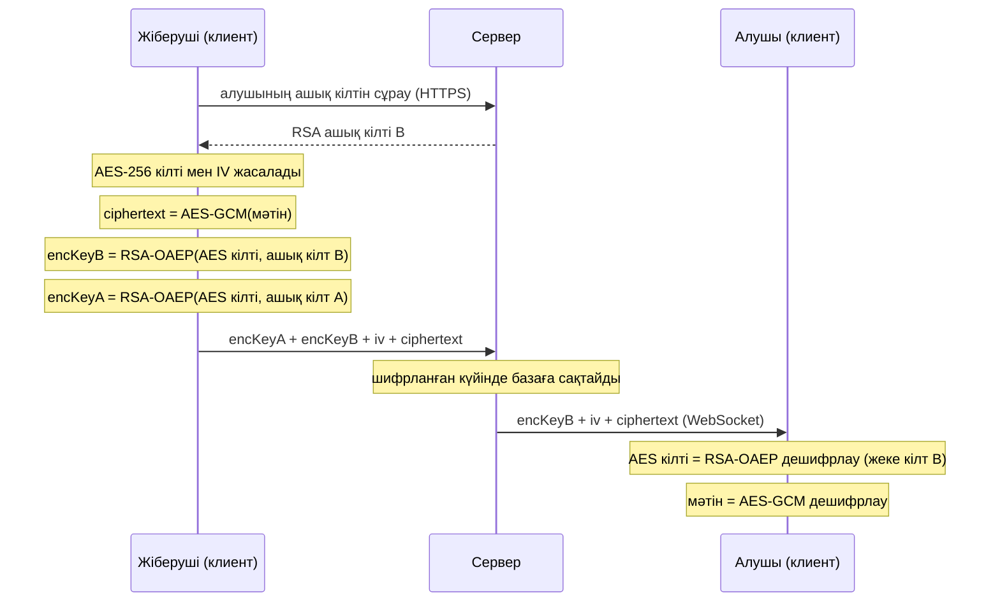
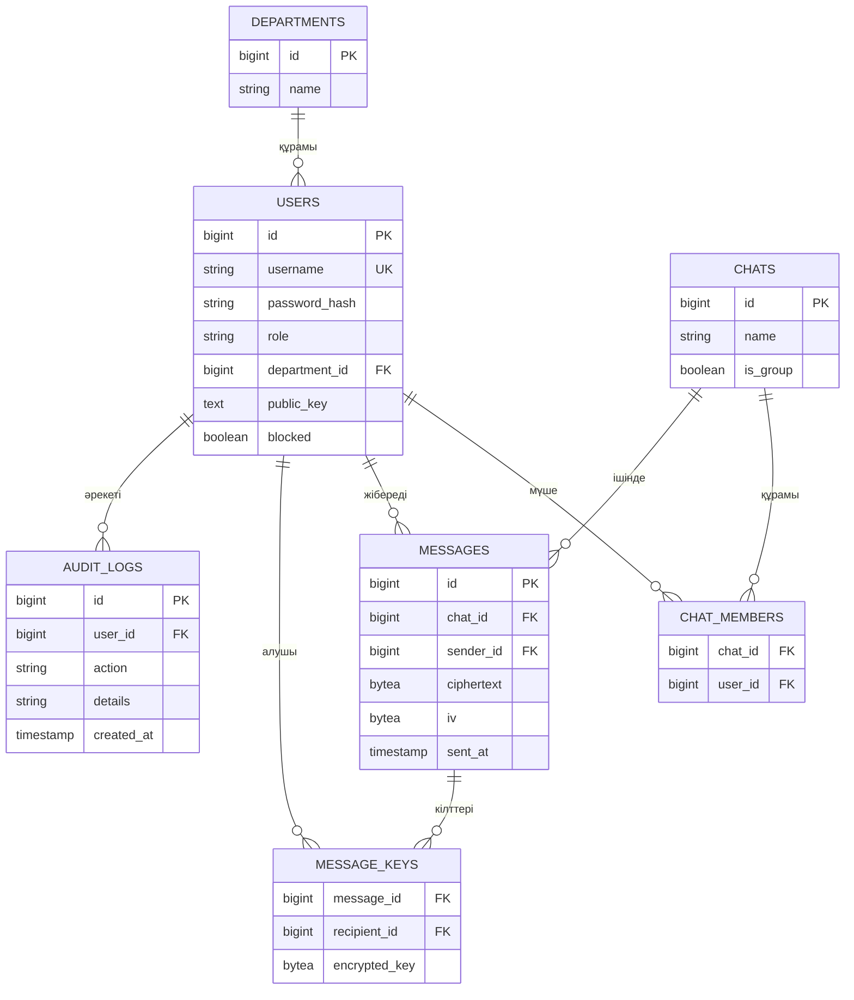

# secure-messenger

Қауіпсіз корпоративтік мессенджер (Java, Spring Boot, JavaFX).

Шифрланған клиент–сервер чат: пайдаланушы аутентификациясы, рөлдер (RBAC), жеке және топтық чат, админ панелі, аудит журналы.

## Мазмұны
1. [Мақсат және мүмкіндіктер](#1-мақсат-және-мүмкіндіктер)
2. [Технологиялар](#2-технологиялар)
3. [Қауіпсіздік шешімдері](#3-қауіпсіздік-шешімдері)
4. [Модульдер](#4-модульдер-maven)
5. [UML диаграммалары](#5-uml-диаграммалары)
6. [Негізгі тәуекелдер](#6-негізгі-тәуекелдер)
7. [Спринттер](#7-спринттер)
8. [Команда](#8-команда)
9. [Research](#9-research)

## 1. Мақсат және мүмкіндіктер
- Шифрланған клиент–сервер чат (RSA + AES-256-GCM, TLS)
- Тіркелу, логин, JWT аутентификациясы
- Корпоративтік рөлдер (`EMPLOYEE`, `MANAGER`, `ADMIN`, `AUDITOR`), бөлімдер (departments)
- Админ панелі, аудит журналы
- Жеке, топтық және бөлім чаты

## 2. Технологиялар
| Бөлім | Таңдау | Себебі |
|---|---|---|
| Тіл | Java 17+ | Тапсырма талабы |
| Сервер | Spring Boot (Web, Security, WebSocket, Data JPA) | Дайын аутентификация, REST және WebSocket |
| Клиент | JavaFX | Тапсырма талабы, десктоп UI |
| Криптография | JCA (java.security, javax.crypto) | Стандартты кітапхана, сыртқы тәуелділік керек емес |
| БД | PostgreSQL (production), H2 (тест/даму) | H2 CI-да жеңіл |
| Құрастыру | Maven (көп модульді) | Модульдерді бөлу оңай |
| Тест | JUnit 5 | Кемінде 20 тест талап етіледі |
| CI | GitHub Actions | Автотест |

## 3. Қауіпсіздік шешімдері
- **Пароль:** BCrypt арқылы хэштеледі, ашық түрде сақталмайды.
- **Аутентификация:** логиннен кейін JWT токен беріледі, оның ішінде рөл болады.
- **RBAC:** корпоративтік 4 рөл. Рұқсат рөлге байланысты (`@PreAuthorize`), рұқсаты жоқ болса `403`.

| Рөл | Кім | Не істей алады |
|---|---|---|
| `EMPLOYEE` | Қарапайым қызметкер | Тіркелу, логин, жеке және топтық чат, хабарлама жіберу/оқу |
| `MANAGER` | Бөлім басшысы | `EMPLOYEE` мүмкіндіктері + өз бөлімінің чатын құру, бөлім мүшелерін қосу/шығару және көру |
| `ADMIN` | Жүйе әкімшісі | `EMPLOYEE` мүмкіндіктері + пайдаланушыларды блоктау, рөл тағайындау, бөлімдерді басқару |
| `AUDITOR` | Аудитор / қауіпсіздік қызметі | Аудит журналын тек оқу. Хабарлама мәтінін көрмейді (шифрланған) |

  `AUDITOR` әкімшіден бөлек, себебі әкімші өз әрекетінің ізін өшіре немесе жасыра алмауы керек (міндеттерді бөлу принципі).
- **Байланыс:** TLS (HTTPS/WSS), development кезінде self-signed сертификат.
- **Хабарлама шифрлауы (гибридті):**
  1. Әр пайдаланушы тіркелгенде RSA-2048 кілт жұбын жасайды. Жеке кілт клиентте қалады, ашық кілт серверге жіберіледі.
  2. Әр хабарламаға жаңа AES-256-GCM кілті және кездейсоқ `iv` жасалады, хабарлама осымен шифрланады (`ciphertext` + `iv` сақталады).
  3. AES кілті чаттың әр мүшесінің және жіберушінің RSA ашық кілтімен бөлек шифрланып, `message_keys` ішінде сақталады.
  4. Сервер тек шифрланған деректі көреді және сақтайды.
- **Аудит:** логин (сәтті/сәтсіз), рөл өзгерісі, чат құру әрекеттері журналға жазылады.
- **Құпия деректер:** keystore, JWT secret және БД паролі репозиторийге түспейді, environment variables арқылы беріледі.

## 4. Модульдер (Maven)
```
secure-messenger/
├── common/      # DTO, ортақ класстар
├── crypto/      # RSA+AES (JCA), JUnit тесттер
├── server/      # Spring Boot: auth, RBAC, chat, admin, audit
├── client/      # JavaFX UI
└── .github/workflows/ci.yml
```

## 5. UML диаграммалары

### Use case диаграммасы


Бастапқы код: [01-usecase.puml](docs/uml/01-usecase.puml)

### Class диаграммасы


Бастапқы код: [02-class.puml](docs/uml/02-class.puml)

### Sequence: хабарлама жіберу



### ER диаграммасы



## 6. Негізгі тәуекелдер
| Тәуекел | Шешімі |
|---|---|
| Топтық чатта кілт тарату күрделі | Әр хабарламаның AES кілтін әр мүшенің RSA ашық кілтімен бөлек шифрлау (`message_keys`) |
| Мүше чаттан шыққанда оның қолжетімділігі | Жаңа хабарламалар үшін оған кілт жасалмайды. Бұрынғыларын оқи алады, бұл v1.0 шектеуі |
| Жеке кілт жоғалса, тарихты ашу мүмкін емес | Жеке кілтті клиентте қорғалған keystore-да сақтау |
| Сервер ашық кілтті алмастыруы мүмкін | Кілттің саусақ ізін (fingerprint) пайдаланушылар салыстырады |
| JavaFX + Maven баптауы | Бірінші аптада скелетті дайындап, барлығында іске қосылатынын тексеру |
| Командадағы жұмыс теңсіздігі | Үлес commit/PR тарихымен бағаланады, сондықтан әркім өз модулінде PR жасайды |

## 7. Спринттер
1. **Жоспар және архитектура:** UML, репозиторий, Trello.
2. **Негізгі функциялар:** логин, чат, шифрлау.
3. **Қауіпсіздікті қатайту және қорғау:** TLS, RBAC, аудит, тесттер, CI, v1.0 release.

## 8. Команда
| Аты-жөні | Рөл | Research |
|---|---|---|
| Тұрлыбек Нұрсұлтан | Team Lead, Backend (аутентификация, RBAC, чат API) | 1–2 |
| Махаматдин Даниэлдин | Криптография | 3–4 |
| Талғатұлы Дәулет | Клиент (JavaFX) | 5–6 |
| Серікұлы Асылжан | DevOps, QA | 7–8 |

## 9. Research

### Backend (1–2)

**1. BCrypt + JWT**
- Пароль BCrypt хешімен сақталады, salt хештің ішінде.
- Логиннен кейін JWT беріледі (`sub`, `role`, `exp`). Клиент `Authorization: Bearer <token>` жібереді.
- Токен өмірі қысқа, JWT secret environment variable ішінде.

**2. RBAC және чат API**
- Рұқсат `@PreAuthorize` арқылы тексеріледі, рұқсат жоқ болса `403`. `MANAGER` тек өз бөлімін басқарады.
- REST: `/api/auth/*`, `/api/chats`, `/api/admin/*`, `/api/audit`. Нақты уақыт: WebSocket (STOMP, `/ws`), JWT қосылу кезінде тексеріледі.
- Сервер хабарламаны шифрланған күйінде сақтап, жібереді.

### Криптография (3–4)

**3. RSA + AES гибрид**
- RSA баяу, AES жылдам: мәтін AES-GCM-мен, AES кілті RSA-мен шифрланады.
- `AES/GCM/NoPadding` (256 бит, 12 байт IV), `RSA/ECB/OAEPWithSHA-256AndMGF1Padding` (2048 бит). Java-да OAEP әдепкіде MGF1 үшін SHA-1 алады, SHA-256 үшін `OAEPParameterSpec` керек.
- Әр хабарламаға жаңа AES кілті, сондықтан IV қайталанбайды.
- AES кілті әр мүшенің және жіберушінің ашық кілтімен бөлек шифрланады (`message_keys`). Жіберуші өз кілтімен де шифрланады, әйтпесе өз хабарламасын оқи алмайды.
- GCM tag хабарлама өзгертілсе, қате береді.

**4. Кілт алмасу және TLS**
- Клиент тіркелгенде RSA жұбын жасайды: ашық кілт серверге, жеке кілт құрылғыда.
- Серверден ашық кілт алмастырылмауы үшін fingerprint салыстырылады.
- TLS арнаны қорғайды, E2E шифрлау мазмұнды қорғайды.
- Spring Boot: `server.ssl.key-store` (PKCS12), `server.ssl.key-store-password` (environment variable), `server.ssl.enabled-protocols=TLSv1.3,TLSv1.2`.
- Дамыту кезінде `keytool -genkeypair` (өзі қол қойған сертификат), клиент truststore арқылы сенеді. Keystore мен пароль репоға салынбайды.

### Клиент (5–6)

**5. JavaFX экрандары**
- Логин/тіркелу, чат тізімі, чат терезесі. Рөлге қарай қосымша экран: `MANAGER`, `ADMIN`, `AUDITOR`.
- UI батырманы жасыра алады, бірақ тексеруді сервер жасайды.
- `.fxml` + `Controller` + `Service`. Желі фондық ағында, экран `Platform.runLater` арқылы жаңарады.

**6. Сервермен байланыс**
- REST: `HttpClient`, нақты уақыт: WebSocket/STOMP. JWT жадта, әр сұранысқа Bearer.
- Шифрлау мен дешифрлау клиентте жасалады, UI тек ашық мәтінді көреді.
- `401` болса, логин экранына қайтады.

### DevOps + QA (7–8)

**7. База және аудит**
- PostgreSQL, тест үшін H2. Кестелер ER диаграммасында. `messages` ішінде тек `ciphertext` және `iv`.
- Аудитке логин, рөл өзгерісі, чат құру жазылады, хабарлама мәтіні жазылмайды. `AUDITOR` журналды тек оқиды.

**8. CI, тесттер, Git**
- GitHub Actions: push және PR кезінде `mvn -B verify`. 20+ JUnit 5 тест: криптография, аутентификация, RBAC, чат.
- `main` тек PR арқылы (кемінде 1 тексеруші), жұмыс `feature/*` тармақтарында.
- Құпиялар `.gitignore` және environment variables/GitHub Secrets арқылы. Trello: Backlog, To Do, In Progress, Code Review, Done.

### Келесі қадам (11/11)
- **Backend:** Maven скелеті, логин + JWT, қарапайым чат.
- **Криптография:** `AesGcmService`, `RsaKeyService`, прототип, алғашқы тесттер.
- **Клиент:** JavaFX скелеті, логин және чат экраны.
- **DevOps + QA:** репозиторий, Trello, CI, H2.

Әрқайсысы кемінде 1 PR жасайды және 1 PR тексереді.

## Лицензия
MIT, [LICENSE](LICENSE) файлын қараңыз.
