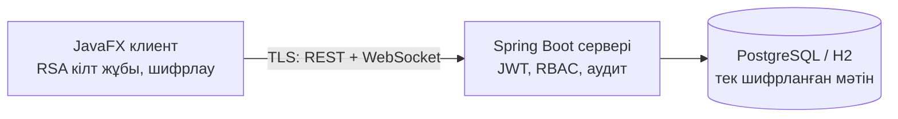
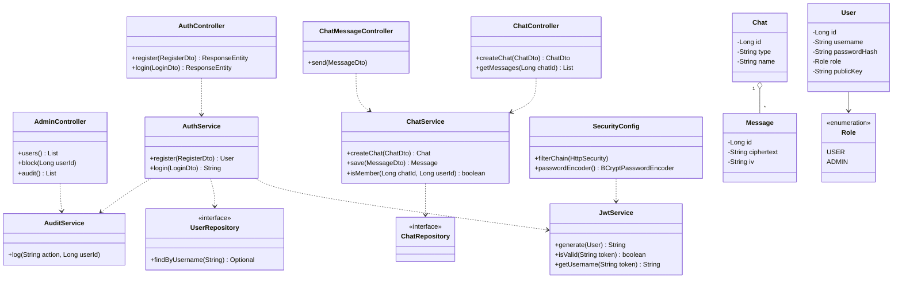
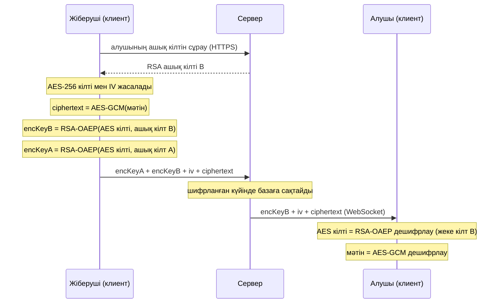
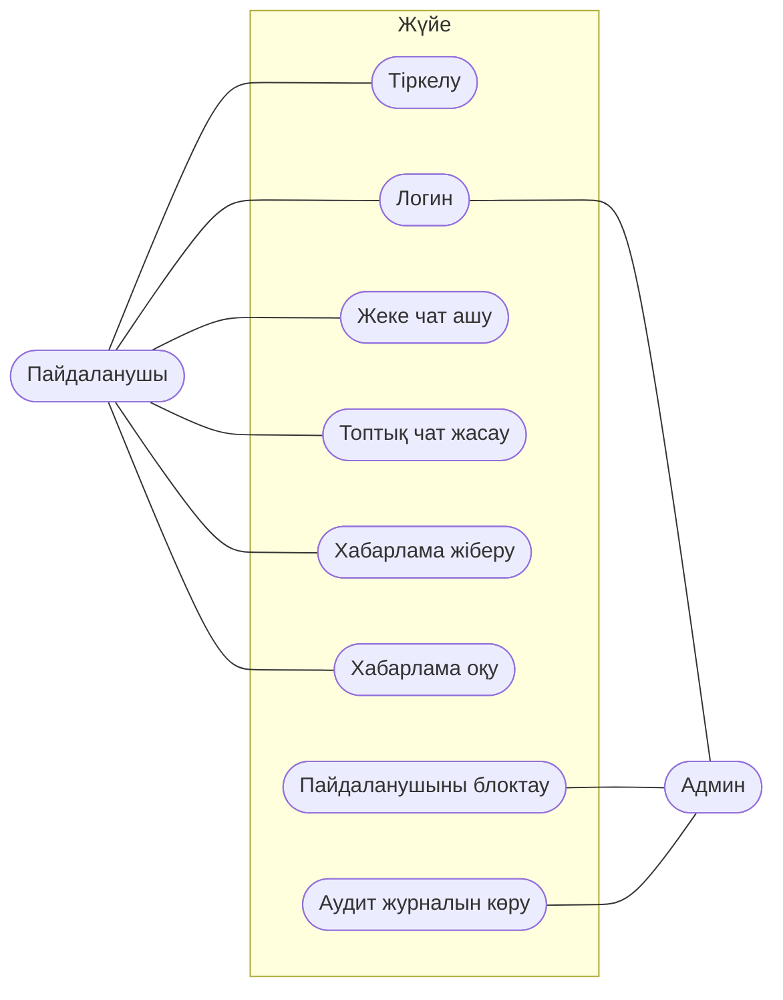
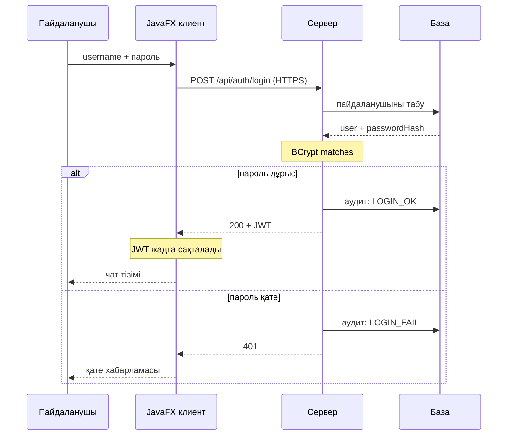
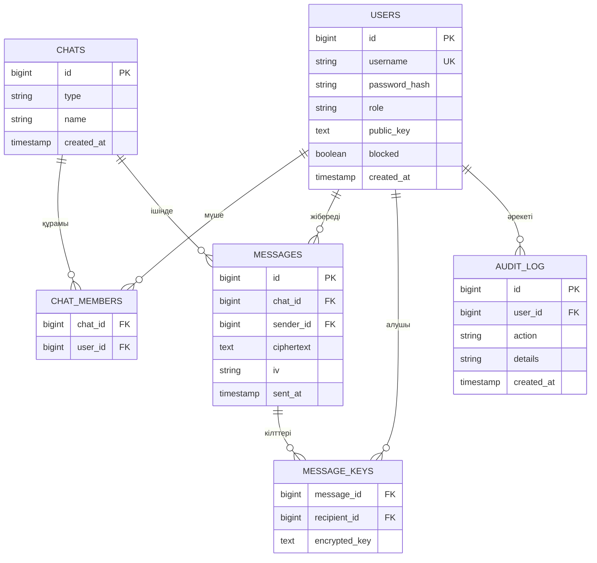

# Қауіпсіз чат: Research / UML

Spring Boot сервері, JavaFX клиенті, RSA+AES шифрлау. Мерзім: **4/11**.

## Команда

| № | Аты-жөні | Рөл | Бөлімдер |
|---|---|---|---|
| 1 | Тұрлыбек Нұрсұлтан | Team Lead + Backend | 1–2 |
| 2 | Махаматдин Даниэлдин | Криптография | 3–4 |
| 3 | Тадғатұлы Дәулет | Клиент (JavaFX) | 5–6 |
| 4 | Серікұлы Асылжан | DevOps + QA | 7–8 |

## Жалпы схема



- Хабарлама клиентте шифрланады, серверде тек шифрланған мәтін сақталады.
- Әрқайсысына commit және pull request міндетті.
- UML файлдары: [docs/uml/](docs/uml/)

## Team Lead + Backend (1–2)

### 1. Аутентификация: BCrypt + JWT

- Пароль базада ашық күйде сақталмайды. `BCryptPasswordEncoder` пароль хешін жасайды, salt хештің ішіне автоматты түрде қосылады.
- Бір пароль әр жолы әртүрлі хеш береді. Тексеру: `matches(пароль, хеш)`.
- Логиннен кейін сервер **JWT** береді: `header.payload.signature`. Payload ішінде `sub` (username), `role`, `exp` (мерзімі).
- Клиент әр сұраныста `Authorization: Bearer <token>` жібереді. Сервер қолтаңбаны тексереді.
- Токен өмірі қысқа (мысалы, 1 сағат).
- JWT secret репоға салынбайды, ол environment variable ішінде тұрады.

### 2. RBAC және чат API / WebSocket

- Рөлдер: `USER`, `ADMIN`. Қорғау: `@PreAuthorize("hasRole('ADMIN')")`.
- Жеке чат — 2 мүшелі чат, топтық чат — көп мүшелі чат. Екеуі бір модельмен жұмыс істейді.

| Эндпоинт | Не істейді | Кім |
|---|---|---|
| `POST /api/auth/register` | тіркелу | барлығы |
| `POST /api/auth/login` | JWT алу | барлығы |
| `GET /api/chats` | менің чаттарым | USER |
| `POST /api/chats` | жеке/топтық чат ашу | USER |
| `GET /api/chats/{id}/messages` | хабарлама тарихы | чат мүшесі |
| `GET /api/admin/users` | пайдаланушылар тізімі | ADMIN |
| `GET /api/admin/audit` | аудит журналы | ADMIN |

- WebSocket (STOMP): қосылу `/ws`, жіберу `/app/chat.send`, алу `/topic/chat.{id}`.
- JWT WebSocket қосылған кезде тексеріледі.
- Чатқа тек мүшелер жаза алады, бұл `ChatService.isMember()` арқылы тексеріледі.
- Сервер хабарламаны шифрланған күйінде сақтап, жібереді. Мәтінін көрмейді.

#### Диаграмма: сервердің класстары



## Криптография (3–4)

### 3. RSA + AES гибридті шифрлау

- RSA баяу және тек кішкентай деректі шифрлайды. AES жылдам. Сондықтан хабарлама AES-пен, AES кілті RSA-мен шифрланады.
- Алгоритмдер (JCA):
  - `AES/GCM/NoPadding`: 256 бит кілт, 12 байт IV, 128 бит tag.
  - `RSA/ECB/OAEPWithSHA-256AndMGF1Padding`: 2048 бит кілт.
- Ескерту: Java-да OAEP әдепкіде MGF1 үшін SHA-1 алады. SHA-256 керек болса, `OAEPParameterSpec` арқылы нақты көрсету керек.
- Жіберу кезінде:
  1. `KeyGenerator` AES кілтін жасайды, `SecureRandom` IV жасайды.
  2. Мәтін AES-GCM-мен шифрланады.
  3. AES кілті алушының RSA ашық кілтімен шифрланады.
  4. Серверге `encryptedKey`, `iv`, `ciphertext` жіберіледі.
- GCM tag мәтіннің өзгермегенін тексереді. Мәтін бүлінсе, дешифрлау қате береді (`AEADBadTagException`).
- Әр хабарламаға жаңа AES кілті жасалады, сондықтан IV қайталану қаупі жоқ.
- Топтық чатта хабарлама бір рет шифрланады, ал AES кілті әр мүшенің ашық кілтімен бөлек шифрланады.
- AES кілті жіберушінің өз ашық кілтімен де шифрланады. Әйтпесе жіберуші өз хабарламасын кейін оқи алмайды. Сондықтан `message_keys` ішінде жіберушіге де жол болады (жеке чатта 2 жол: жіберуші және алушы).
- Сервер тек шифрланған мәтінді сақтайды. Жеке кілт тек клиентте.

### 4. Кілт алмасу және TLS

- Тіркелген кезде клиент RSA жұбын жасайды. **Ашық кілт** серверге жіберіледі, **жеке кілт** құрылғыда қалады, парольмен қорғалады.
- Жіберуші алдымен алушының ашық кілтін серверден алады.
- Қауіп: сервер ашық кілтті алмастыра алады (MITM). Қорғану: кілттің SHA-256 саусақ ізін (fingerprint) екі пайдаланушы бір-бірімен салыстырады.
- TLS клиент пен сервер арасындағы арнаны қорғайды. E2E шифрлау хабарлама мазмұнын серверден қорғайды. Бұл екі бөлек қорғаныс.
- Spring Boot конфигурациясы:
  - `server.ssl.key-store` (PKCS12 файл)
  - `server.ssl.key-store-password` (environment variable арқылы)
  - `server.ssl.enabled-protocols=TLSv1.3,TLSv1.2`
- Дамыту кезінде өзі қол қойған сертификат: `keytool -genkeypair`.
- Клиент сервер сертификатына truststore арқылы сенеді.
- Keystore файлы мен пароль репоға салынбайды.

#### Диаграмма: хабарлама жіберу



## Клиент, JavaFX (5–6)

### 5. Экрандар және құрылым

- Экрандар: логин/тіркелу, чат тізімі, чат терезесі (жеке және топтық), жаңа чат немесе топ жасау.
- Әр экран: `.fxml` (көрінісі) және `Controller` (логикасы).
- Желі мен криптография `Service` қабатында тұрады, контроллер оларды шақырады.
- Папкалар: `view/` (fxml), `controller/`, `service/`, `model/`.
- Чат терезесі: `ListView` (хабарламалар), `TextField`, «Жіберу» батырмасы.
- Желі сұранысы UI ағынында жасалмайды, әйтпесе терезе қатып қалады. Сұраныс фондық ағында (`Task`) жүреді, нәтиже `Platform.runLater(...)` арқылы экранға шығады.

### 6. Сервермен байланыс

- Логин, тіркелу, тарих: HTTPS REST, `java.net.http.HttpClient`. JSON үшін Jackson.
- Нақты уақыттағы хабарлама: WebSocket/STOMP (`/ws`), Spring `WebSocketStompClient`.
- JWT жадта сақталады (`SessionHolder`) және әр сұранысқа `Authorization: Bearer` ретінде қосылады. Файлға жазылмайды.
- TLS: клиент сервер сертификатына truststore арқылы сенеді.
- Шифрлау клиентте жасалады: жібергенше `CryptoService.encrypt`, алғаннан кейін `decrypt`. UI тек ашық мәтінді көреді.
- Қателер:
  - `401` болса, логин экранына қайтады.
  - Байланыс үзілсе, хабарлама көрсетіліп, қайта қосылуға әрекет жасалады.

#### Диаграмма 1: use case

> Mermaid-те use case түрі жоқ, сондықтан flowchart қолданылды.



#### Диаграмма 2: логин (sequence)



## DevOps + QA (7–8)

### 7. База, admin панелі, аудит журналы

- PostgreSQL негізгі база, H2 (in-memory) тесттер мен жергілікті дамыту үшін. Spring Data JPA, профильдер: `dev` және `prod`.
- Кестелер: `users`, `chats`, `chat_members`, `messages`, `message_keys`, `audit_log` (диаграмманы төменнен қараңыз).
- `messages` ішінде тек `ciphertext` және `iv`. Шифрланған AES кілті `message_keys` кестесінде тұрады: әр алушыға және жіберушіге бір жолдан.
- Admin панелі (тек `ADMIN` рөлі): пайдаланушылар тізімі, блоктау/ашу, рөл өзгерту, аудит журналын көру. Экран JavaFX-те болады, 5–6 бөлімдердің иесімен келісіледі.
- Аудит журналы: кім, не істеді, қашан. Жазылатын оқиғалар:
  - `LOGIN_OK`, `LOGIN_FAIL`, `REGISTER`
  - `CHAT_CREATE`
  - `MESSAGE_SENT` (тек метадеректер)
  - `ADMIN_ACTION`
- Хабарлама мәтіні журналға жазылмайды.

### 8. CI, тесттер, Git ережелері

- GitHub Actions: push және PR кезінде `mvn -B verify` жұмыс істейді. Тест құласа, PR-ды біріктіруге болмайды.

```yaml
name: CI
on:
  push:
    branches: [main, develop]
  pull_request:
jobs:
  build:
    runs-on: ubuntu-latest
    steps:
      - uses: actions/checkout@v4
      - uses: actions/setup-java@v4
        with:
          distribution: temurin
          java-version: 17
          cache: maven
      - run: mvn -B verify
```

- 20+ JUnit 5 тест (жоспар):

| Топ | Саны | Не тексереді |
|---|---|---|
| Криптография | 8 | AES-GCM шифрлау/дешифрлау, бүлінген мәтін қате береді, қате кілт ашпайды, RSA кілтті орау, IV әр жолы әртүрлі |
| Аутентификация | 6 | BCrypt, JWT дұрыс, мерзімі өткен, қолтаңбасы қате |
| RBAC | 4 | `USER` admin эндпоинтіне кірсе `403`, токенсіз `401` (`MockMvc`) |
| Чат және база | 4 | мүше емес адам жаза алмайды, хабарлама сақталады (H2) |

- Git:
  - `main` тек PR арқылы өзгереді, кемінде 1 тексерушімен (branch protection).
  - Жұмыс `feature/*` тармақтарында, біріктіру `develop` арқылы.
  - PR-да Trello карточкасына сілтеме болады, Issues байланыстырылады.
- Құпиялар: `.gitignore` ішінде `*.p12`, `*.jks`, `.env`, `application-local.properties`. JWT secret мен keystore паролі environment variables ішінде, CI-да GitHub Secrets.
- Trello бағандары: Backlog, To Do, In Progress, Code Review, Done. Карточкада жауапты, мерзім, рөл және GitHub PR (Power-Up).
- README және LICENSE (MIT) осы бөлімнің иесінде.

#### Диаграмма: ER



## Келесі қадам (11/11)

| Бөлімдер | Не істейді |
|---|---|
| 1–2 | Maven/Gradle скелеті, `main` және `develop` тармақтары; Тіркелу мен логин, JWT; Қарапайым чат эндпоинті |
| 3–4 | Крипто модулі: `AesGcmService`, `RsaKeyService`; RSA+AES прототипі: шифрлау мен дешифрлау жұмыс істейді; Алғашқы тесттер (дұрыс және бүлінген мәтін) |
| 5–6 | JavaFX скелеті (Maven модулі); Логин/тіркелу экраны; Қарапайым чат экраны |
| 7–8 | GitHub репозиторийі және Trello тақтасы, `.gitignore`; CI workflow (`ci.yml`); H2 және алғашқы entity-лер (`User`, `Chat`, `Message`); README және LICENSE |

Әрқайсысы кемінде 1 PR жасайды және 1 PR тексереді.
