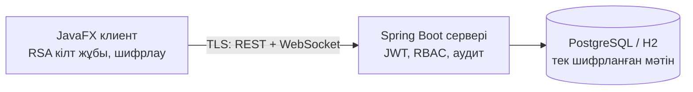
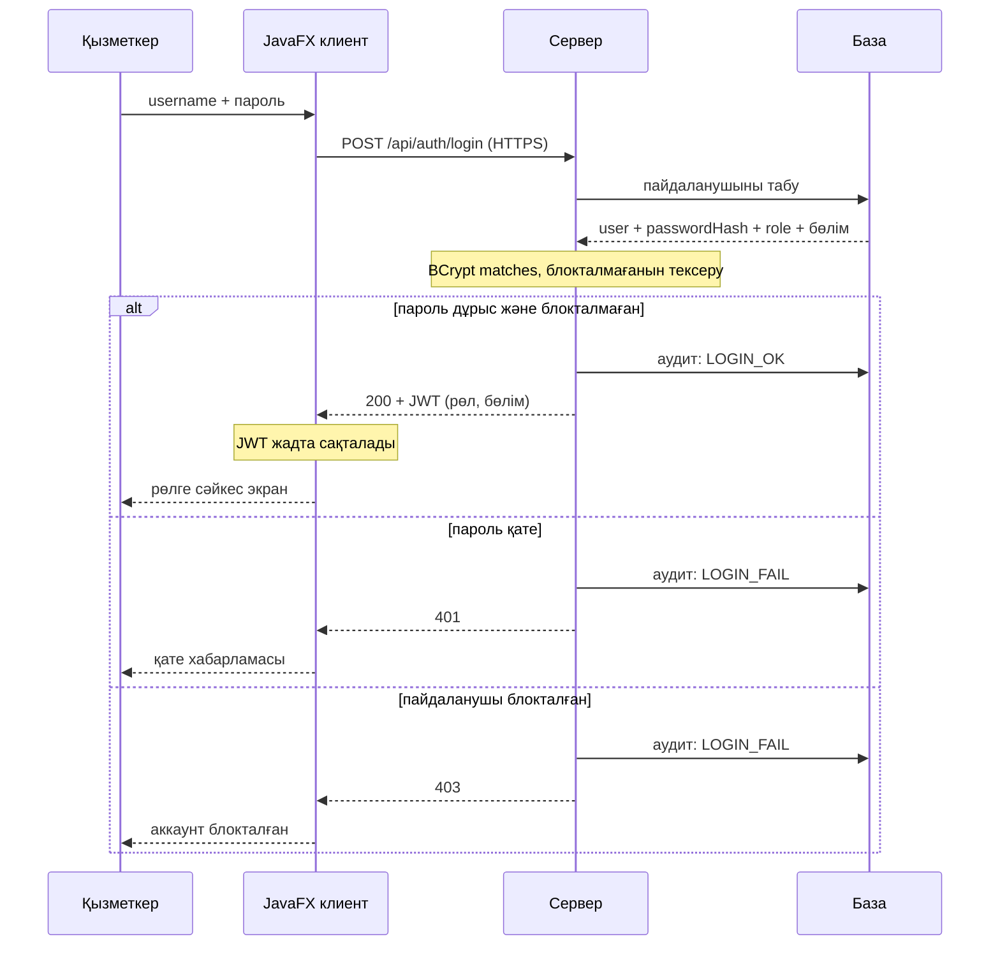
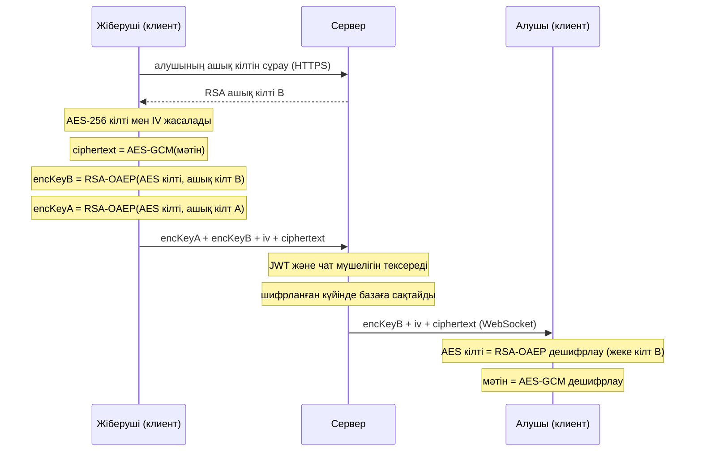
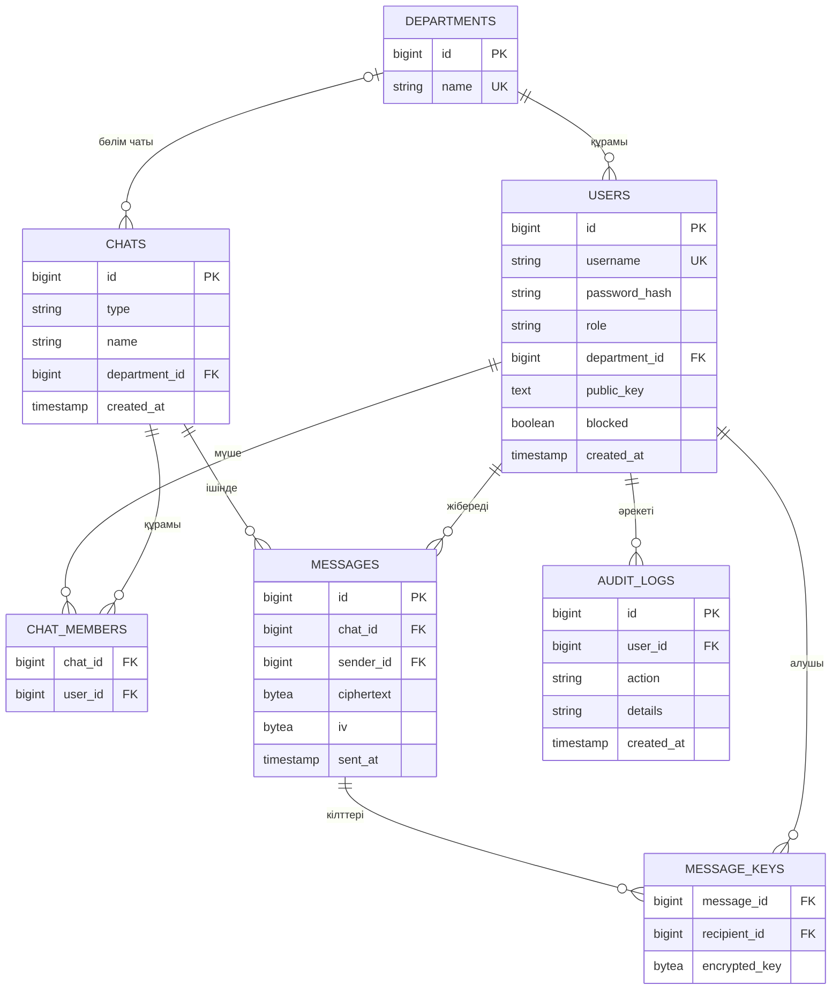

# secure-messenger

Қауіпсіз корпоративтік мессенджер (Java, Spring Boot, JavaFX).

Шифрланған клиент–сервер чат: пайдаланушы аутентификациясы, рөлдер (RBAC), жеке және топтық чат, админ панелі, аудит журналы.

## Мазмұны
1. [Мақсат және мүмкіндіктер](#1-мақсат-және-мүмкіндіктер)
2. [Технологиялар](#2-технологиялар)
3. [Қауіпсіздік шешімдері](#3-қауіпсіздік-шешімдері)
4. [Модульдер](#4-модульдер-maven)
5. [UML диаграммалары](#5-uml-диаграммалары)
6. [Негізгі тәуекелдер](#6-негізгі-тәуекелдер)
7. [Спринттер](#7-спринттер)
8. [Команда](#8-команда)
9. [Research (4/11)](#9-research-411)

## 1. Мақсат және мүмкіндіктер
- Шифрланған клиент–сервер чат (RSA + AES-256-GCM, TLS)
- Тіркелу, логин, JWT аутентификациясы
- Корпоративтік рөлдер (`EMPLOYEE`, `MANAGER`, `ADMIN`, `AUDITOR`), бөлімдер (departments)
- Админ панелі, аудит журналы
- Жеке, топтық және бөлім чаты

## 2. Технологиялар
| Бөлім | Таңдау | Себебі |
|---|---|---|
| Тіл | Java 17+ | Тапсырма талабы |
| Сервер | Spring Boot (Web, Security, WebSocket, Data JPA) | Дайын аутентификация, REST және WebSocket |
| Клиент | JavaFX | Тапсырма талабы, десктоп UI |
| Криптография | JCA (java.security, javax.crypto) | Стандартты кітапхана, сыртқы тәуелділік керек емес |
| БД | PostgreSQL (production), H2 (тест/даму) | H2 CI-да жеңіл |
| Құрастыру | Maven (көп модульді) | Модульдерді бөлу оңай |
| Тест | JUnit 5 | Кемінде 20 тест талап етіледі |
| CI | GitHub Actions | Автотест |

## 3. Қауіпсіздік шешімдері
- **Пароль:** BCrypt арқылы хэштеледі, ашық түрде сақталмайды.
- **Аутентификация:** логиннен кейін JWT токен беріледі, оның ішінде рөл болады.
- **RBAC:** корпоративтік 4 рөл. Рұқсат рөлге байланысты (`@PreAuthorize`), рұқсаты жоқ болса `403`.

| Рөл | Кім | Не істей алады |
|---|---|---|
| `EMPLOYEE` | Қарапайым қызметкер | Тіркелу, логин, жеке және топтық чат, хабарлама жіберу/оқу |
| `MANAGER` | Бөлім басшысы | `EMPLOYEE` мүмкіндіктері + өз бөлімінің чатын құру, бөлім мүшелерін қосу/шығару және көру |
| `ADMIN` | Жүйе әкімшісі | `EMPLOYEE` мүмкіндіктері + пайдаланушыларды блоктау, рөл тағайындау, бөлімдерді басқару |
| `AUDITOR` | Аудитор / қауіпсіздік қызметі | Аудит журналын тек оқу. Хабарлама мәтінін көрмейді (шифрланған) |

  `AUDITOR` әкімшіден бөлек, себебі әкімші өз әрекетінің ізін өшіре немесе жасыра алмауы керек (міндеттерді бөлу принципі).
- **Бөлім (department):** `MANAGER` тек өз бөлімін басқара алады, сондықтан рөлден басқа пайдаланушының бөлімі де тексеріледі.
- **Байланыс:** TLS (HTTPS/WSS), development кезінде self-signed сертификат.
- **Хабарлама шифрлауы (гибридті):**
  1. Әр пайдаланушы тіркелгенде RSA-2048 кілт жұбын жасайды. Жеке кілт клиентте қалады, ашық кілт серверге жіберіледі.
  2. Әр хабарламаға жаңа AES-256-GCM кілті және кездейсоқ `iv` жасалады.
  3. Хабарлама осы кілтпен шифрланады (`ciphertext` + `iv` сақталады).
  4. AES кілті чаттың әр мүшесінің RSA ашық кілтімен бөлек шифрланып, `message_keys` ішінде сақталады. Жіберушіге де жол қосылады, әйтпесе ол өз хабарламасын кейін оқи алмайды.
  5. Алушы өз жеке кілтімен AES кілтін, содан кейін хабарламаны ашады.
  6. Сервер тек шифрланған деректі көреді және сақтайды.
- **Аудит:** логин (сәтті/сәтсіз), рөл өзгерісі, чат құру әрекеттері журналға жазылады.
- **Құпия деректер:** keystore, JWT secret және БД паролі репозиторийге түспейді, environment variables арқылы беріледі.

## 4. Модульдер (Maven)
```
secure-messenger/
├── common/      # DTO, ортақ класстар
├── crypto/      # RSA+AES (JCA), JUnit тесттер
├── server/      # Spring Boot: auth, RBAC, chat, admin, audit
├── client/      # JavaFX UI
└── .github/workflows/ci.yml
```



## 5. UML диаграммалары

### Use case диаграммасы


Бастапқы код: [01-usecase.puml](docs/uml/01-usecase.puml)

### Class диаграммасы


Бастапқы код: [02-class.puml](docs/uml/02-class.puml)

### Sequence: логин



### Sequence: хабарлама жіберу



### ER диаграммасы



`users.role`: `EMPLOYEE`, `MANAGER`, `ADMIN`, `AUDITOR`. `chats.type`: `PRIVATE`, `GROUP`, `DEPARTMENT`.

## 6. Негізгі тәуекелдер
| Тәуекел | Шешімі |
|---|---|
| Топтық чатта кілт тарату күрделі | Әр хабарламаның AES кілтін әр мүшенің RSA ашық кілтімен бөлек шифрлау (`message_keys`) |
| Мүше чаттан шыққанда оның қолжетімділігі | Жаңа хабарламалар үшін оған кілт жасалмайды, сондықтан жаңаларын оқи алмайды. Бұрынғыларын оқи алады, бұл v1.0 шектеуі |
| Жеке кілт жоғалса, тарихты ашу мүмкін емес | Жеке кілтті клиентте қорғалған keystore-да сақтау |
| Сервер ашық кілтті алмастыруы мүмкін (MITM) | Кілттің SHA-256 саусақ ізін (fingerprint) пайдаланушылар салыстырады |
| JavaFX + Maven баптауы | Бірінші аптада скелетті дайындап, барлығында іске қосылатынын тексеру |
| Командадағы жұмыс теңсіздігі | Үлес commit/PR тарихымен бағаланады, сондықтан әркім өз модулінде PR жасайды |

## 7. Спринттер
1. **Жоспар және архитектура:** UML, репозиторий, Trello.
2. **Негізгі функциялар:** логин, чат, шифрлау.
3. **Қауіпсіздікті қатайту және қорғау:** TLS, RBAC, аудит, тесттер, CI, v1.0 release.

## 8. Команда
| Аты-жөні | Рөл | Research бөлімдері |
|---|---|---|
| Тұрлыбек Нұрсұлтан | Team Lead, Backend (аутентификация, RBAC, чат API) | 1–2 |
| Махаматдин Даниэлдин | Криптография | 3–4 |
| Талғатұлы Дәулет | Клиент (JavaFX) | 5–6 |
| Серікұлы Асылжан | DevOps, QA | 7–8 |

## 9. Research (4/11)

Әр бөлім командадағы бір рөлге тиесілі. Диаграммалар 5-бөлімде.

### Team Lead + Backend

#### 1. Аутентификация: BCrypt + JWT
- Пароль базада ашық күйде сақталмайды. `BCryptPasswordEncoder` хеш жасайды, salt хештің ішіне автоматты түрде қосылады.
- Бір пароль әр жолы әртүрлі хеш береді. Тексеру: `matches(пароль, хеш)`.
- Логиннен кейін сервер **JWT** береді: `header.payload.signature`. Payload ішінде `sub` (username), `role`, `departmentId`, `exp` (мерзімі).
- Клиент әр сұраныста `Authorization: Bearer <token>` жібереді. Сервер қолтаңбаны тексереді.
- Токен өмірі қысқа (мысалы, 1 сағат). JWT secret репоға салынбайды, ол environment variable ішінде тұрады.
- Блокталған пайдаланушы логин жасай алмайды (`403`).

#### 2. RBAC және чат API / WebSocket
- 4 рөл (3-бөлімдегі кесте). Қорғау: `@PreAuthorize("hasRole('ADMIN')")`, `hasAnyRole('MANAGER','ADMIN')`.
- `MANAGER` үшін рөл жеткіліксіз: сервис пайдаланушының бөлімі мен сұралған бөлімнің сәйкестігін де тексереді.
- Жаңа тіркелген пайдаланушы `EMPLOYEE` болады, рөлді тек `ADMIN` өзгертеді.

| Эндпоинт | Не істейді | Кім |
|---|---|---|
| `POST /api/auth/register` | тіркелу | барлығы |
| `POST /api/auth/login` | JWT алу | барлығы |
| `GET /api/chats` | менің чаттарым | барлық рөл |
| `POST /api/chats` | жеке/топтық чат ашу | `EMPLOYEE` және жоғары |
| `GET /api/chats/{id}/messages` | хабарлама тарихы | чат мүшесі |
| `POST /api/departments/{id}/chat` | бөлім чатын құру | `MANAGER` (өз бөлімі) |
| `POST /api/departments/{id}/members` | бөлім мүшесін қосу/шығару | `MANAGER` (өз бөлімі) |
| `GET /api/admin/users` | пайдаланушылар тізімі | `ADMIN` |
| `PUT /api/admin/users/{id}/role` | рөл тағайындау | `ADMIN` |
| `PUT /api/admin/users/{id}/block` | блоктау | `ADMIN` |
| `GET /api/audit` | аудит журналы (тек оқу) | `AUDITOR` |

- WebSocket (STOMP): қосылу `/ws`, жіберу `/app/chat.send`, алу `/topic/chat.{id}`. JWT қосылу кезінде тексеріледі.
- Чатқа тек мүшелер жаза алады. Сервер хабарламаны шифрланған күйінде сақтап, жібереді.
- Әкімші аудит журналын өзгерте де, өшіре де алмайды.

### Криптография

#### 3. RSA + AES гибридті шифрлау
- RSA баяу және тек кішкентай деректі шифрлайды. AES жылдам. Сондықтан хабарлама AES-пен, AES кілті RSA-мен шифрланады.
- Алгоритмдер (JCA):
  - `AES/GCM/NoPadding`: 256 бит кілт, 12 байт IV, 128 бит tag.
  - `RSA/ECB/OAEPWithSHA-256AndMGF1Padding`: 2048 бит кілт.
- Ескерту: Java-да OAEP әдепкіде MGF1 үшін SHA-1 алады. SHA-256 керек болса, `OAEPParameterSpec` арқылы нақты көрсету керек.
- Жіберу кезінде:
  1. `KeyGenerator` AES кілтін жасайды, `SecureRandom` IV жасайды.
  2. Мәтін AES-GCM-мен шифрланады.
  3. AES кілті алушының RSA ашық кілтімен шифрланады.
  4. Серверге `encryptedKey`, `iv`, `ciphertext` жіберіледі.
- GCM tag мәтіннің өзгермегенін тексереді. Мәтін бүлінсе, дешифрлау қате береді (`AEADBadTagException`).
- Әр хабарламаға жаңа AES кілті жасалады, сондықтан IV қайталану қаупі жоқ.
- Топтық чатта хабарлама бір рет шифрланады, ал AES кілті әр мүшенің ашық кілтімен бөлек шифрланады.
- AES кілті жіберушінің өз ашық кілтімен де шифрланады. Әйтпесе жіберуші өз хабарламасын кейін оқи алмайды. Сондықтан `message_keys` ішінде жіберушіге де жол болады (жеке чатта 2 жол: жіберуші және алушы).
- Сервер тек шифрланған мәтінді сақтайды. Жеке кілт тек клиентте.

#### 4. Кілт алмасу және TLS
- Тіркелген кезде клиент RSA жұбын жасайды. **Ашық кілт** серверге жіберіледі, **жеке кілт** құрылғыда қалады, парольмен қорғалады.
- Жіберуші алдымен алушының ашық кілтін серверден алады.
- Қауіп: сервер ашық кілтті алмастыра алады (MITM). Қорғану: кілттің SHA-256 саусақ ізін (fingerprint) екі пайдаланушы бір-бірімен салыстырады.
- TLS клиент пен сервер арасындағы арнаны қорғайды. E2E шифрлау хабарлама мазмұнын серверден қорғайды. Бұл екі бөлек қорғаныс.
- Spring Boot конфигурациясы:
  - `server.ssl.key-store` (PKCS12 файл)
  - `server.ssl.key-store-password` (environment variable арқылы)
  - `server.ssl.enabled-protocols=TLSv1.3,TLSv1.2`
- Дамыту кезінде өзі қол қойған сертификат: `keytool -genkeypair`.
- Клиент сервер сертификатына truststore арқылы сенеді.
- Keystore файлы мен пароль репоға салынбайды.

### Клиент

#### 5. Экрандар және құрылым
- Экрандар: логин/тіркелу, чат тізімі, чат терезесі (жеке, топтық, бөлім чаты).
- Рөлге қарай қосымша экрандар: `MANAGER` үшін бөлім мүшелерін басқару, `ADMIN` үшін пайдаланушылар мен бөлімдер, `AUDITOR` үшін аудит журналы (тек оқу).
- Клиент JWT ішіндегі `role` бойынша қажетсіз батырмаларды жасырады. Нақты тексеру серверде: жасырылған әрекетті сервер бәрібір `403` қайтарады.
- Әр экран: `.fxml` (көрінісі) және `Controller` (логикасы). Желі мен криптография `Service` қабатында тұрады.
- Папкалар: `view/`, `controller/`, `service/`, `model/`.
- Желі сұранысы UI ағынында жасалмайды, әйтпесе терезе қатып қалады. Сұраныс фондық ағында (`Task`) жүреді, нәтиже `Platform.runLater(...)` арқылы экранға шығады.

#### 6. Сервермен байланыс
- Логин, тіркелу, тарих: HTTPS REST, `java.net.http.HttpClient`. JSON үшін Jackson.
- Нақты уақыттағы хабарлама: WebSocket/STOMP (`/ws`), Spring `WebSocketStompClient`.
- JWT жадта сақталады (`SessionHolder`) және әр сұранысқа `Authorization: Bearer` ретінде қосылады. Файлға жазылмайды.
- TLS: клиент сервер сертификатына truststore арқылы сенеді.
- Шифрлау клиентте жасалады: жібергенше `CryptoService.encrypt`, алғаннан кейін `decrypt`. UI тек ашық мәтінді көреді.
- Қателер: `401` болса, логин экранына қайтады. Байланыс үзілсе, хабарлама көрсетіліп, қайта қосылуға әрекет жасалады.

### DevOps + QA

#### 7. База, админ панелі, аудит
- PostgreSQL негізгі база, H2 (in-memory) тесттер мен жергілікті дамыту үшін. Spring Data JPA, профильдер: `dev` және `prod`.
- Кестелер: `users`, `departments`, `chats`, `chat_members`, `messages`, `message_keys`, `audit_logs` (ER диаграммасы 5-бөлімде).
- `messages` ішінде тек `ciphertext` және `iv`. Шифрланған AES кілті `message_keys` кестесінде тұрады: әр алушыға және жіберушіге бір жолдан.
- `ADMIN` панелі: пайдаланушылар тізімі, блоктау/ашу, рөл тағайындау, бөлімдерді басқару.
- `AUDITOR` журналды тек оқиды.
- Аудит журналы: кім, не істеді, қашан. Жазылатын оқиғалар: `LOGIN_OK`, `LOGIN_FAIL`, `REGISTER`, `CHAT_CREATE`, `ROLE_CHANGE`, `USER_BLOCK`, `DEPT_MEMBER_ADD`, `DEPT_MEMBER_REMOVE`. Хабарлама мәтіні журналға жазылмайды.

#### 8. CI, тесттер, Git ережелері
- GitHub Actions: push және PR кезінде `mvn -B verify` жұмыс істейді. Тест құласа, PR-ды біріктіруге болмайды.

```yaml
name: CI
on:
  push:
    branches: [main, develop]
  pull_request:
jobs:
  build:
    runs-on: ubuntu-latest
    steps:
      - uses: actions/checkout@v4
      - uses: actions/setup-java@v4
        with:
          distribution: temurin
          java-version: 17
          cache: maven
      - run: mvn -B verify
```

- 23 JUnit 5 тест (жоспар):

| Топ | Саны | Не тексереді |
|---|---|---|
| Криптография | 8 | AES-GCM шифрлау/дешифрлау, бүлінген мәтін қате береді, қате кілт ашпайды, RSA кілтті орау, IV әр жолы әртүрлі |
| Аутентификация | 6 | BCrypt, JWT дұрыс, мерзімі өткен, қолтаңбасы қате |
| RBAC | 5 | `EMPLOYEE` admin эндпоинтіне кірсе `403`, `MANAGER` басқа бөлімге `403`, `AUDITOR` журналды оқиды, жаза алмайды, токенсіз `401` (`MockMvc`) |
| Чат және база | 4 | мүше емес адам жаза алмайды, хабарлама сақталады (H2) |

- Git:
  - `main` тек PR арқылы өзгереді, кемінде 1 тексерушімен (branch protection).
  - Жұмыс `feature/*` тармақтарында, біріктіру `develop` арқылы.
  - PR-да Trello карточкасына сілтеме болады, Issues байланыстырылады.
- Құпиялар: `.gitignore` ішінде `*.p12`, `*.jks`, `.env`, `application-local.properties`. JWT secret мен keystore паролі environment variables ішінде, CI-да GitHub Secrets.
- Trello бағандары: Backlog, To Do, In Progress, Code Review, Done. Карточкада жауапты, мерзім, рөл және GitHub PR (Power-Up).

### Келесі қадам (11/11)

| Бөлімдер | Не істейді |
|---|---|
| 1–2 | Maven/Gradle скелеті, `main` және `develop` тармақтары; тіркелу мен логин, JWT; қарапайым чат эндпоинті |
| 3–4 | Крипто модулі: `AesGcmService`, `RsaKeyService`; RSA+AES прототипі; алғашқы тесттер (дұрыс және бүлінген мәтін) |
| 5–6 | JavaFX скелеті (Maven модулі); логин/тіркелу экраны; қарапайым чат экраны |
| 7–8 | GitHub репозиторийі және Trello тақтасы, `.gitignore`; CI workflow (`ci.yml`); H2 және алғашқы entity-лер (`User`, `Department`, `Chat`, `Message`); LICENSE |

Әрқайсысы кемінде 1 PR жасайды және 1 PR тексереді.

## Лицензия
MIT, [LICENSE](LICENSE) файлын қараңыз.
